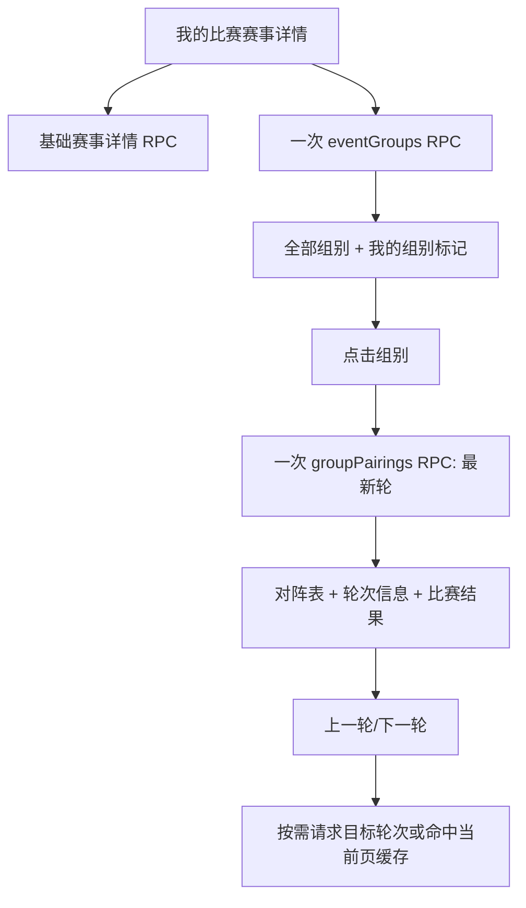

> 由 scope skill 于 2026-08-19 生成
> 状态：已批准 2026-08-19

# 云比赛赛事组别与对阵表

## 目标

在 JCGO 的“我的比赛”赛事详情中补充赛事全部组别，并让用户进入任意组别查看最后一轮对阵及比赛结果，支持按轮次前后查看；保持现有登录、报名赛事列表和赛事基础详情不变，同时控制外部云比赛请求数量，不预加载不必要的数据。

## 决策基线

### 需求边界

- “我的比赛”中的赛事详情展示云比赛官方接口返回的全部组别；用户报名所在组别高亮。
- 组别可点击进入组别对阵视图；任意组别均可查看，不限于用户报名组别。
- 对阵视图默认显示该组接口返回的最后一轮，显示当前轮次与总轮数，并支持上一轮/下一轮。
- 每台对阵至少展示台号、双方棋手、所属队伍、双方胜负和得分；对未配对、缺少结果或缺少棋手的数据使用明确的空值状态，不误判为胜负。
- 不实现独立的“成绩/名次表”，不请求名次表接口。
- 赛事详情或对阵请求失败时，保留已经加载的基础内容，在对应区域显示错误和重试入口。
- 现有云比赛登录、账号切换、订单过滤、赛事基础详情、杭州公开比赛行为保持兼容。
- 页面请求保持克制：详情阶段只加载一次组别列表；进入组别时才加载当前轮；切换轮次每次最多请求一轮；不预加载其他组别、其他轮次或名次表。当前页面已访问过的组别/轮次应复用前端缓存，返回已访问数据不重复请求。

### 技术决策

- 云比赛外部数据继续由 Go 后端适配并转换为前端安全领域模型，React 不解析云比赛原始字段或 JSONP，也不持有云比赛凭证。
- 组别列表与基础赛事详情分离加载：保留现有 `yunbisai.myEventDetail`，新增一次性的 `yunbisai.eventGroups` 请求，使组别请求失败时基础详情仍可展示并可独立重试。
- 对阵按需加载：新增 `yunbisai.groupPairings`，参数为 `groupId` 和可选轮次；省略轮次时调用云比赛接口的最新轮数据，响应中的 `lastbout` 和 `total_bout` 作为当前轮次与总轮数的权威值。轮次切换只请求目标轮次。
- 适配云比赛现有接口：组别使用 `data-center.yunbisai.com/api/lswl-groups/event/{eventId}`；对阵使用 `api.yunbisai.com/request/group/againstplan?groupid={groupId}&bout={bout}`。对阵接口的 JSONP 在后端解包并严格校验，前端只接收规范化结果。
- 组别和对阵接口使用无需用户凭证的公开数据请求；不把登录 token、Cookie 或其他授权字段放入新 RPC 响应、前端状态、URL 或日志。
- 服务端将外部对阵字段归一为稳定的轮次、台号、棋手、队伍、结果和得分模型；胜负映射由后端完成，前端只负责展示。
- 组别高亮依据已由服务器返回的赛事详情中的报名棋手组别与组别名称匹配；该匹配只负责展示状态，不重新实现云比赛规则，也不为高亮再次请求订单或用户数据。

## 设计视图

### 功能设计

用户从“我的比赛”打开一场赛事后，基础赛事详情继续显示赛事时间、地点、报名人和订单信息；详情下方加载全部组别卡片，卡片显示组别名称、参赛人数及可获得的时间信息，报名所在组别明确标记。组别列表只加载一次。

点击组别后，当前详情区域切换为该组对阵视图，保留赛事名称、组别名称和返回赛事详情操作。首次进入显示最后一轮及总轮数；每一台显示台号、双方棋手和队伍，以及双方结果/得分。上一轮和下一轮在边界处禁用。已访问过的轮次再次打开时直接使用当前页面缓存。

对阵数据为空、棋手缺失或结果缺失时仍保留台号/轮次结构，并显示“暂无对阵”或“结果待公布”等明确状态。组别列表或对阵加载失败时只在相应区域显示错误和重试，不清除基础赛事详情或登录状态。

### 技术设计

#### 整体方案

现有 `YunbisaiService` 继续负责认证会话和订单详情；新增公开赛事组别、组别对阵的 client 方法和 service/handler 映射。`eventGroups` 根据赛事 ID 读取全部组别并标记报名组别；`groupPairings` 根据组别 ID 和轮次读取一轮数据，校验 `lastbout`、`total_bout` 与行结构后转换为前端模型。

前端 `YunbisaiMyEventsPanel` 扩展为“赛事详情 / 组别对阵”两个局部视图，不新增应用级路由。赛事详情状态保存组别列表及错误状态；对阵视图保存当前组别、当前轮次和以 `groupId + bout` 为键的结果缓存。进入组别不会提前请求其他组别或轮次，返回赛事详情不会丢失当前会话内已加载的数据。

#### 关键结构

前端安全领域模型至少包含以下信息：

- `YunbisaiEventGroup`：`groupId`、`name`、`playerCount`、可选比赛时间；“我的组别”是前端基于已加载详情字段计算的展示标记。
- `YunbisaiGroupPairings`：`groupId`、`groupName`、`round`、`totalRounds`、`matches`。
- `YunbisaiPairing`：台号、黑/白或双方棋手、双方队伍、双方规范化结果、双方得分；缺失字段保持可选或空状态。

新增 RPC 参数必须校验非空赛事/组别 ID；轮次只接受正整数或省略。非法参数返回稳定的参数错误，不向外部接口发请求。对阵接口返回的未知结果值不得被映射成胜负，保留为待确认状态。

#### 实现流程

1. 赛事详情成功加载并取得 `eventId` 后，前端调用一次 `yunbisai.eventGroups`；成功则渲染全部组别，失败则只显示组别区域错误和重试。
2. 用户点击组别时，若缓存中没有该组最新轮数据，前端调用 `yunbisai.groupPairings({ groupId })`；后端请求 `bout=`，从响应返回的 `lastbout` 定位最新轮并返回规范化对阵。
3. 用户切换轮次时，先检查 `groupId + bout` 缓存；未命中才调用 `yunbisai.groupPairings({ groupId, bout })`。按钮状态由 `round`、`totalRounds` 决定，避免越界请求。
4. 远端非 2xx、JSONP 无法解包、错误 envelope、缺失关键字段或网络错误转换为稳定的云比赛数据错误；不泄露远端响应、Cookie 或 token。
5. 组别或对阵重试只重复失败的局部请求；返回基础详情、切换账号和退出登录沿用现有流程。

### 预估改动面

- `internal/app/yunbisai_client.go` 及测试：增加组别列表和 JSONP 对阵接口适配、字段校验和规范化测试。
- `internal/app/yunbisai.go`、`yunbisai_handlers.go` 及测试：增加组别/对阵领域模型、服务方法、参数校验和 RPC dispatch。
- `web/src/api/types.ts`、`web/src/App.tsx`：增加组别/对阵类型和同源 RPC API 封装。
- `web/src/components/YunbisaiMyEventsPanel.tsx`、对应测试和 `web/src/styles.css`：增加组别列表、我的组别标记、对阵视图、轮次切换、缓存及局部错误状态。
- 测试覆盖 Go client/service/handler、React 组件交互、请求次数与缓存行为；保留现有云比赛登录、订单和赛事详情回归测试。
- 已确认的 wiki 目标：由 implement 首个工作单元新建 `docs/wiki/cloud-events.md`，沉淀稳定的云比赛详情、组别/对阵数据流和请求控制约定。

## 验收

- 已登录账号打开已报名赛事 → 赛事详情展示全部官方组别，报名所在组别有明确高亮；验证组件测试及真实已完成赛事手工核对。
- 点击任意组别 → 进入该组最后一轮对阵，显示当前轮/总轮数、台号、双方棋手、队伍、胜负和得分；验证 client/service/组件测试。
- 点击上一轮或下一轮 → 只请求目标轮次，正确更新对阵并在边界禁用按钮；验证请求 mock 调用次数和轮次数据。
- 返回后再次进入已访问组别/轮次 → 命中当前页面缓存，不重复发请求；验证组件测试。
- 打开赛事详情 → 组别列表最多触发一次组别接口，不预加载所有组别对阵；不调用独立名次表接口；验证 RPC/client spy。
- 组别或对阵接口失败 → 基础详情保持可见，对应区域提供错误和重试，重试只触发失败接口；验证错误态测试。
- 外部返回空对阵、缺少棋手或未知结果 → 页面显示明确空/待确认状态，不错误显示胜负；验证数据映射测试。
- 现有登录、订单列表、基础赛事详情和杭州公开比赛 → 行为与改动前一致；运行 Go 测试、前端测试和生产构建验证。
- 新增 RPC 和页面状态 → 不包含云比赛 token、Cookie、openId、sCode、sceneId 或 key；验证敏感字段回归测试。
