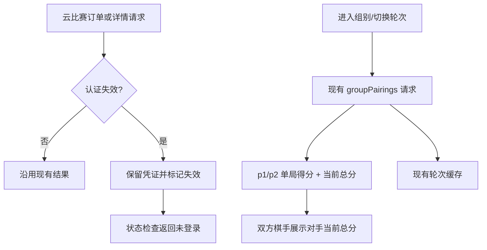

> 由 scope skill 于 2026-08-23 生成
> 状态：已批准 2026-08-23

# 云比赛会话保留与对阵分数展示

## 目标

避免云比赛会话因一次远端失效响应而丢失本地凭证，同时在现有组别对阵表中展示每位棋手的当前赛事总分和本轮对手的当前总分；保持页面请求数量、现有比赛结果展示和登录流程兼容。

## 决策基线

### 需求边界

- 云比赛订单或赛事详情请求返回未登录、401 或 403 时，不自动删除本地 `yunbisai_auth.json`；会话应被标记为失效，页面提示重新登录，且后续请求不得继续使用已失效凭证。
- 用户主动退出登录时保留现有清理行为；重新登录成功时覆盖保存新凭证并清除失效标记。
- 组别对阵表中的每位棋手展示云比赛当前赛事累计总分；现有单局得分、胜负、队伍和台号继续展示。
- 每台对阵中，棋手同时展示其本轮对手的当前累计总分。该字段明确标为“对手当前总分”，不冒充所有历史对手累计分之和的标准对手分。
- 组别对阵首轮/轮次切换不新增独立成绩、名次或排行榜请求；总分必须复用当前对阵接口返回的数据，并沿用现有组别/轮次缓存。
- 云比赛接口缺少总分或对手时，使用“待公布”或“无对手”等明确状态，不填充为 0，也不影响其他对阵字段展示。
- 现有云比赛扫码授权、账号选择、订单列表、赛事详情、组别列表、对阵结果和退出登录行为保持兼容；不显示或转发 token、Cookie 等敏感字段。

### 技术决策

- 后端文件和内存授权存储增加“会话失效”状态。失效状态保留原始凭证文件但使 `Load`/状态检查返回未登录，避免重启后再次把已失效凭证当作有效凭证发送给云比赛。
- `YunbisaiService` 在订单列表或订单详情收到认证失效错误时调用授权存储的失效标记操作，不再调用清理操作；显式 `Logout` 仍调用清理操作，成功授权仍通过正常 `Save` 覆盖旧状态。
- 云比赛对阵适配器读取对阵响应中的 `p1_integral` 和 `p2_integral`，映射为安全领域模型的棋手 `totalScore` 字段；现有 `p1_score`/`p2_score` 继续映射为单局 `score` 字段。
- 前端在 `PairingMatch` 渲染双方棋手时，将另一方的 `totalScore` 作为“对手当前总分”传入展示组件；不新增 RPC、不解析云比赛原始字段、不请求其他轮次来计算标准对手分。
- 组别首次进入、轮次切换和当前页缓存机制保持原设计：当前操作最多请求目标轮次一次，已访问轮次复用缓存。

## 设计视图

### 功能设计

用户打开组别对阵表后，每台对阵继续显示台号、双方棋手、队伍、胜负和本局得分；每位棋手的信息区域增加“当前总分”，并显示另一位棋手的“对手当前总分”。进入下一轮或上一轮时，展示该轮接口返回的对应累计分和对手累计分。轮空、待定棋手或缺少积分时显示明确的无对手/待公布状态。

当云比赛订单接口判定当前会话失效时，JCGO 保留本地授权文件并记录失效状态，前端进入登录提示；在用户重新扫码授权前，状态检查不会继续发起订单请求。用户主动点击退出时仍删除本地授权文件。

### 技术设计

#### 整体方案

授权存储仍是云比赛会话的唯一持有者。失效标记与凭证一起持久化，使文件存在不等于会话有效；`Status`、`MyEvents` 和 `MyEventDetail` 对失效状态返回未登录，前端沿用现有扫码登录入口。`Logout` 是唯一的显式清理路径，成功授权通过 `Save` 写入新的有效状态。

现有对阵 client 继续请求同一个公开 `againstplan` 接口。后端增加对 `p1_integral`/`p2_integral` 的字段读取和模型映射，前端只接收 `totalScore`。对阵组件把双方模型互相传递，仅用已返回的另一方总分显示“对手当前总分”，不做额外网络请求或跨轮计算。

#### 关键结构

- `YunbisaiAuth`：增加可持久化的失效状态；有效性判断同时要求凭证完整且未被标记失效。
- `YunbisaiAuthStore`：增加标记失效职责；文件存储保留原 JSON，内存存储同步保存失效状态；`Clear` 继续代表显式退出。
- Go `YunbisaiPairingPlayer` / TypeScript `YunbisaiPairingPlayer` 类型：增加可选 `totalScore`；`score` 仍表示单局得分。
- 对阵展示组件：棋手自身显示“当前总分”，从另一方模型读取“对手当前总分”；缺失值使用稳定的空值文案。

#### 实现流程

1. 订单列表或详情调用遇到认证失效错误时，服务调用存储的失效标记并返回 `LoggedIn: false`；任何后续状态检查先识别失效标记，不访问云比赛订单接口。
2. 前端收到未登录结果后进入现有扫码登录界面；重新授权保存新会话后，失效状态被清除并恢复现有订单加载流程。
3. 用户进入组别或切换未缓存轮次时，沿用一次 `groupPairings` RPC；client 读取双方 `integral` 和单局 `score`，service 转成安全模型，前端按双方关系渲染当前总分与对手当前总分。
4. 已缓存轮次直接复用；失败时只重试目标对阵请求。任何缺失总分、对手或结果的行保留结构并显示待公布/无对手状态。

### 预估改动面

- `internal/app/yunbisai_auth.go`、`internal/app/yunbisai.go` 及测试：增加失效状态持久化/内存处理，替换自动清理路径，保留显式退出清理。
- `internal/app/yunbisai_client.go` 及测试：读取 `p1_integral`/`p2_integral` 并映射到远端对阵模型。
- `web/src/api/types.ts`、`web/src/components/YunbisaiMyEventsPanel.tsx` 及组件测试：增加 `totalScore` 字段和双方当前总分展示，覆盖缺失字段、轮空和请求缓存行为。
- `docs/wiki/cloud-events.md`：同步云比赛会话失效保留策略、对阵总分字段和无额外成绩请求的稳定约定。
- 验证范围：Go 单元测试、前端组件/API 测试、生产构建；不新增外部请求，不改变敏感字段边界。

## 验收

- 订单列表或详情收到认证失效 → 本地 `yunbisai_auth.json` 仍存在且包含原凭证，授权状态标记失效，后续状态检查不再使用该凭证；验证授权存储和 service 测试。
- 用户主动退出 → 本地授权文件被清理；重新登录成功 → 新凭证覆盖保存且失效状态消失；验证登录/退出回归测试。
- 已登录用户进入任意组别对阵 → 每位棋手显示当前总分、对手当前总分、单局得分、结果、队伍和台号；验证 client/service/组件测试。
- 对阵接口缺少 `integral`、对手或棋手 → 显示待公布/无对手，不显示伪造的 0 分或错误胜负；验证映射和组件测试。
- 进入组别、切换轮次及返回已访问轮次 → 不新增成绩/名次请求，未缓存目标轮次最多请求一次，缓存命中不重复请求；验证组件调用次数。
- 现有登录、订单、赛事详情、组别、对阵结果、缓存和公开杭州赛事 → 行为保持兼容；运行 Go 测试、前端测试和生产构建。
- 前端 RPC 结果与日志 → 不包含 token、Cookie、openId、sCode、sceneId 或 key；验证敏感字段回归测试。
